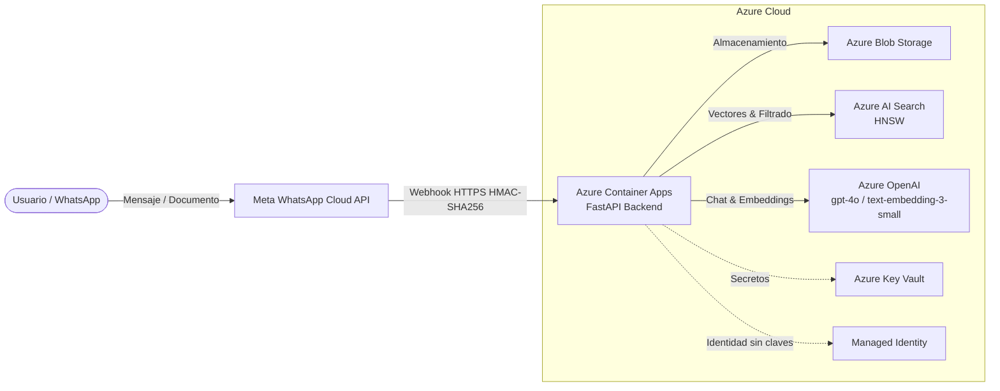

# DocuMind AI 🧠📄

> **Asistente documental conversacional para WhatsApp** impulsado por Microsoft Azure y Retrieval-Augmented Generation (RAG).

DocuMind AI permite a los usuarios enviar documentos (PDF, DOCX, TXT) directamente a través de WhatsApp y realizar preguntas en lenguaje natural sobre su contenido. La solución combina procesamiento inteligente de texto, búsqueda vectorial semántica e inferencia generativa con citas precisas a las fuentes.

---

## 🚀 Guía de Despliegue Paso a Paso

Para desplegar la solución completa de inicio a fin en Azure y conectarla con WhatsApp, consulta la guía detallada:

👉 **[Guía Completa de Despliegue End-to-End (`docs/05-guias/001-guia-completa.md`)](docs/05-guias/001-guia-completa.md)**

### Resumen del Flujo de Puesta en Marcha:

| Paso | Sección en la Guía | Descripción |
|---|---|---|
| **1** | [Pre-requisitos](docs/05-guias/001-guia-completa.md#1-pre-requisitos) | Instalación de herramientas (Azure CLI, Terraform, Docker, Python, uv) y configuración de la app en Meta for Developers. |
| **2** | [Validación de código y tests](docs/05-guias/001-guia-completa.md#2-validacion-de-codigo-y-tests) | Verificación local de dependencias, ejecución de la suite de pruebas unitarias/integración y validación de linters/tipos. |
| **3** | [Infraestructura Azure con Terraform](docs/05-guias/001-guia-completa.md#3-infraestructura-azure-con-terraform) | Aprovisionamiento modular de Resource Group, Managed Identity, Key Vault, Azure AI Search, Azure OpenAI, Blob Storage y ACR. |
| **4** | [Credenciales en Key Vault](docs/05-guias/001-guia-completa.md#4-credenciales-en-key-vault) | Carga segura de tokens de WhatsApp (`access-token`, `app-secret`, `verify-token`) en Key Vault mediante Azure CLI. |
| **5** | [Imagen Docker → ACR](docs/05-guias/001-guia-completa.md#5-imagen-docker--acr) | Compilación multiplataforma (`linux/amd64`) y publicación de la imagen en Azure Container Registry. |
| **6** | [Activar Container App](docs/05-guias/001-guia-completa.md#6-activar-container-app) | Despliegue del contenedor en Azure Container Apps inyectando la configuración y secretos de forma segura. |
| **7** | [Configurar Webhook WhatsApp](docs/05-guias/001-guia-completa.md#7-configurar-webhook-whatsapp) | Registro de la URL de webhook y verify token en el portal de Meta y suscripción al evento `messages`. |
| **8** | [Troubleshooting y Limpieza](docs/05-guias/001-guia-completa.md#8-troubleshooting) | Diagnóstico de errores comunes y destrucción total de recursos (`terraform destroy`) para evitar costos no deseados. |

---

## 🏛️ Arquitectura & Stack Tecnológico



- **Canal de Usuario:** WhatsApp Cloud API (Meta Graph API v20.0).
- **Backend Core:** Python 3.13+, FastAPI, Pydantic v2, `uv`.
- **Procesamiento de Documentos:** `pypdf`, `python-docx`, `tiktoken` (chunking adaptativo).
- **Embeddings & LLM:** Microsoft Foundry / Azure OpenAI (`text-embedding-3-small`, `gpt-4o`).
- **Búsqueda Vectorial:** Azure AI Search con índice HNSW y filtrado por usuario.
- **Almacenamiento:** Azure Blob Storage privado para documentos.
- **Seguridad & Gobernanza:** Azure Key Vault, User Assigned Managed Identity (sin API keys hardcodeadas) y validación estricta HMAC-SHA256 de webhooks.

---

## 🧪 Validación y Calidad de Código

El proyecto sigue estándares rigurosos de **Clean Architecture**, **SOLID** y modularización de pruebas en capas (`tests/unit` y `tests/integration`).

### 1. Sincronizar dependencias
```bash
uv sync --all-groups
```

### 2. Ejecutar suite de pruebas (43 tests)
```bash
uv run pytest -v
```

### 3. Linters y formateo
```bash
uv run ruff check src tests
uv run ruff format --check src tests
```

### 4. Chequeo estático de tipos
```bash
uv run mypy src tests
```

---

## 📁 Estructura del Repositorio

```text
├── .github/              # Automatizaciones y flujos de trabajo
├── docker/
│   └── Dockerfile        # Imagen optimizada multi-stage basada en distroless/python
├── docs/
│   ├── 01-business/      # Casos de negocio, historias de usuario y métricas
│   ├── 02-architecture/  # Diagramas, vista de despliegue, seguridad y ADRs
│   └── 05-guias/
│       └── 001-guia-completa.md  # 📘 Guía paso a paso de despliegue
├── src/
│   └── documind/
│       ├── api/          # Endpoints FastAPI, routers y validación de webhook
│       ├── clients/      # Clientes Azure (AI Search, Blob, OpenAI) y WhatsApp
│       ├── config/       # Pydantic Settings y configuración de logging
│       ├── processing/   # Extracción de texto, embeddings y chunking
│       └── services/     # Casos de uso: Ingestión documental y pipeline RAG
├── terraform/
│   ├── environments/dev/ # Configuración del entorno dev de Terraform
│   └── modules/          # Módulos reutilizables (base y composición)
└── tests/
    ├── conftest.py       # Fixtures y mocks aislados
    ├── integration/      # Pruebas de integración de endpoints y handlers
    └── unit/             # Pruebas unitarias con cobertura 1:1 por módulo
```

---

## 🔒 Seguridad y Privacidad

- **Cero Secretos en Git:** Ningún token ni clave sensible se versiona en el repositorio.
- **Retención de Documentos:** Los documentos y fragmentos indexados no tienen expiración automática.
- **Autenticación Basada en Identidad:** El backend interactúa con los servicios de Azure mediante Managed Identities y roles RBAC de mínimo privilegio.
