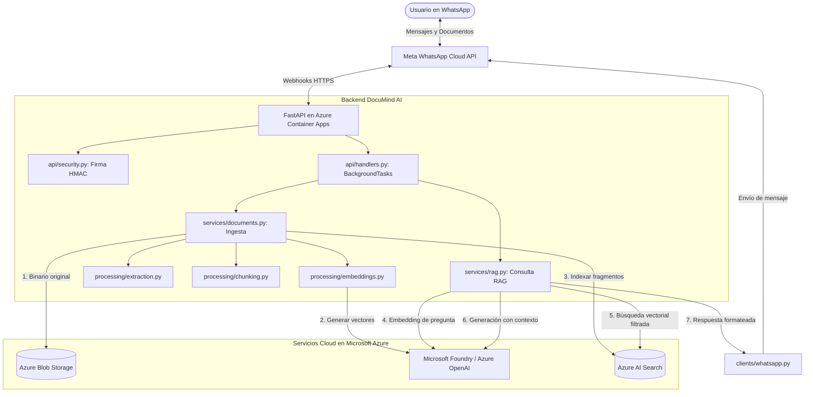

# Visión General de la Arquitectura — DocuMind AI

## Propósito

DocuMind AI permite a los usuarios interactuar con sus documentos cargados mediante preguntas en lenguaje natural a través de WhatsApp. Emplea un patrón RAG (Retrieval-Augmented Generation) para recuperar fragmentos relevantes y generar respuestas citando fuentes.

---

## Diagrama de Arquitectura

---

## Módulos del Sistema y Responsabilidades

| Paquete | Módulo | Responsabilidad |
|---|---|---|
| `api` | `whatsapp_webhook.py` | Rutas FastAPI (`GET /webhook` verificación, `POST /webhook` eventos). |
| `api` | `security.py` | Verificación de firma criptográfica HMAC-SHA256 de Meta. |
| `api` | `schemas.py` | Modelos Pydantic para payloads de eventos y mensajes de WhatsApp. |
| `api` | `handlers.py` | Tareas en segundo plano (`BackgroundTasks`) para desacoplar el webhook. |
| `services` | `documents.py` | Orquestación de ingesta: descarga, storage, parseo, chunking e indexación. |
| `services` | `rag.py` | Pipeline RAG: embedding de pregunta, búsqueda vectorial y síntesis con LLM. |
| `processing` | `extraction.py` | Extracción de texto desde PDF (`pypdf`), DOCX (`python-docx`) y TXT. |
| `processing` | `chunking.py` | División en fragmentos de tokens con solapamiento (`tiktoken`). |
| `processing` | `embeddings.py` | Enriquecimiento de fragmentos con vectores numéricos. |
| `clients` | `azure_credential.py`| Resolución de credenciales Entra ID (`DefaultAzureCredential` / `ClientSecretCredential`). |
| `clients` | `blob_storage.py` | Carga y descarga de archivos originales en Azure Blob Storage. |
| `clients` | `ai_search.py` | Creación de índices HNSW, indexación y búsqueda vectorial filtrada por usuario. |
| `clients` | `foundry.py` | Chat completions (`gpt-4o`) y embeddings (`text-embedding-3-small`) con reintentos exponenciales. |
| `clients` | `whatsapp.py` | Envío de mensajes de texto, indicadores de lectura y descarga de media. |
| `config` | `settings.py` | Carga de configuración tipada desde variables de entorno con `BaseSettings`. |

---

## Stack Tecnológico

| Área | Tecnología |
|---|---|
| Lenguaje | Python 3.12+ con gestión de paquetes `uv` |
| Web Framework | FastAPI + Uvicorn |
| Modelos de IA | Microsoft Foundry / Azure OpenAI (`gpt-4o`, `text-embedding-3-small`) |
| Búsqueda Vectorial | Azure AI Search (índice HNSW, similitud coseno) |
| Almacenamiento | Azure Blob Storage |
| Hosting | Azure Container Apps |
| Contenedores | Docker + Azure Container Registry |
| Seguridad | Azure Key Vault + Entra ID Managed Identity |
| Infraestructura | Terraform modular |
| Mensajería | Meta WhatsApp Cloud API (Graph API v20.0) |
