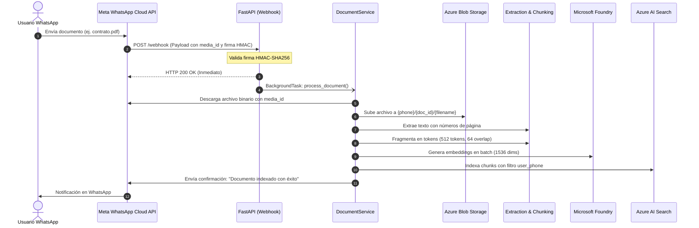
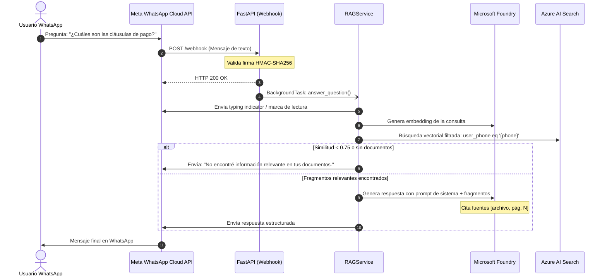

# Flujos de Ejecución — DocuMind AI

DocuMind AI opera en dos flujos principales activados por eventos de webhook de WhatsApp: **Ingesta Documental** y **Consulta RAG**.

---

## 1. Flujo de Ingesta Documental

Se ejecuta cuando un usuario envía un documento adjunto (PDF, DOCX o TXT).

### Pasos de la Ingesta

1. **Recepción:** El webhook valida la firma HMAC del encabezado `X-Hub-Signature-256`. Si es válida, responde `200 OK` de inmediato a Meta para evitar reintentos.
2. **Descarga de Media:** En una tarea en segundo plano (`BackgroundTasks`), se consulta la URL del recurso en Graph API y se descargan los bytes con token de autorización.
3. **Persistencia Original:** Los bytes se guardan en el contenedor de Blob Storage bajo el prefijo aislado del usuario (`safe_phone/document_id/safe_filename`).
4. **Parseo y Chunking:** Se extrae el texto por página y se divide en fragmentos con `tiktoken`.
5. **Vectorización e Indexación:** Los fragmentos se envían en lote a Microsoft Foundry para obtener sus vectores y se indexan en Azure AI Search.
6. **Notificación:** Se envía un mensaje al usuario confirmando que su documento está listo para recibir preguntas.

---

## 2. Flujo de Consulta RAG

Se ejecuta cuando el usuario envía un mensaje de texto con una pregunta.

### Pasos de la Consulta

1. **Indicador Visual:** Se envía un indicador de escritura para brindar retroalimentación inmediata al usuario.
2. **Embedding de la Pregunta:** Se convierte la consulta en un vector mediante Microsoft Foundry (`text-embedding-3-small`).
3. **Búsqueda Vectorial Aislada:** Se ejecuta una consulta de similitud de coseno en Azure AI Search aplicando obligatoriamente el filtro `user_phone eq '{sender_phone}'` para garantizar que ningún usuario acceda a documentos ajenos.
4. **Evaluación de Relevancia:** Si el score de similitud no supera el umbral configurado (`0.75`), se responde con cortesía indicando que no hay suficiente evidencia.
5. **Generación con Referencias:** Si hay contexto válido, se llama al modelo de lenguaje (`gpt-4o`) con un prompt estricto que prohíbe alucinaciones y exige citas del documento y página.
