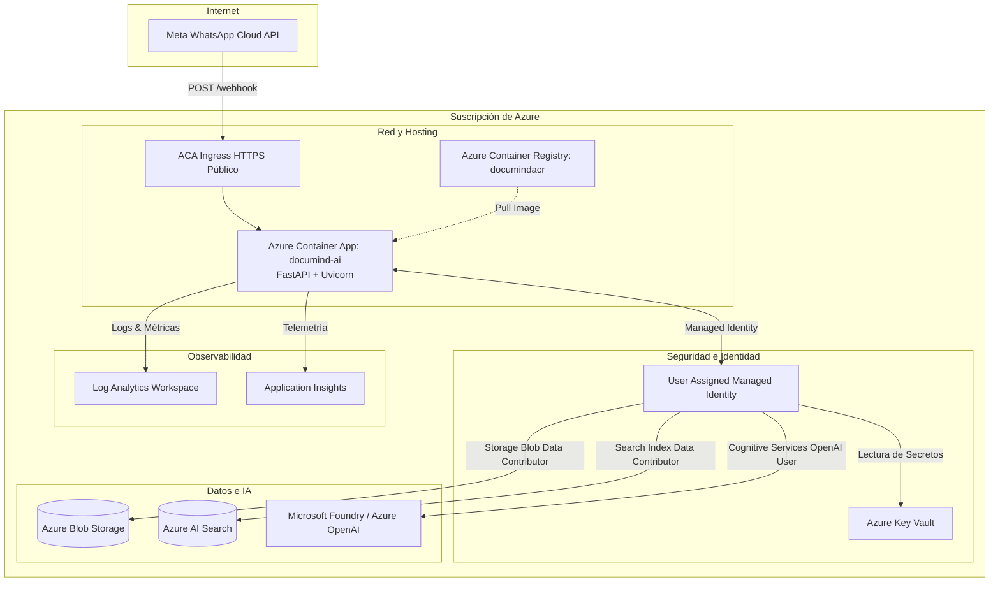

# Vista de Despliegue — DocuMind AI

## Arquitectura de Despliegue en Microsoft Azure

DocuMind AI se ejecuta en una arquitectura serverless basada en **Azure Container Apps (ACA)** conectada de forma segura a los servicios administrados de datos e IA en Azure.

---

## Componentes de la Solución Desplegada

### 1. Ingress y Container App
- **Ingress:** HTTPS habilitado con terminación TLS automática en el dominio asignado por Azure Container Apps (`https://<app>.<region>.azurecontainerapps.io`).
- **Escalado:** Configuración de escalado basado en concurrencia de peticiones HTTP (0 a 10 réplicas según tráfico).
- **Health Check:** Endpoints expuestos en `/health` para sondas de liveness y readiness.

### 2. Contenedor Docker
- Basado en `python:3.12-slim` con empaquetado multi-etapa para generar imágenes ligeras y seguras.
- Ejecuta Uvicorn en el puerto 8000 sirviendo la aplicación FastAPI.

### 3. Conexiones Administradas
- **Sin credenciales:** La Container App asume la identidad administrada para autenticarse contra Blob Storage, AI Search y Azure OpenAI mediante tokens Entra ID de corta duración rotados automáticamente por Azure.
- **Secretos de Meta:** El token de acceso y el secreto de webhook de WhatsApp se guardan en Key Vault y se inyectan como variables de entorno seguras en la Container App.
